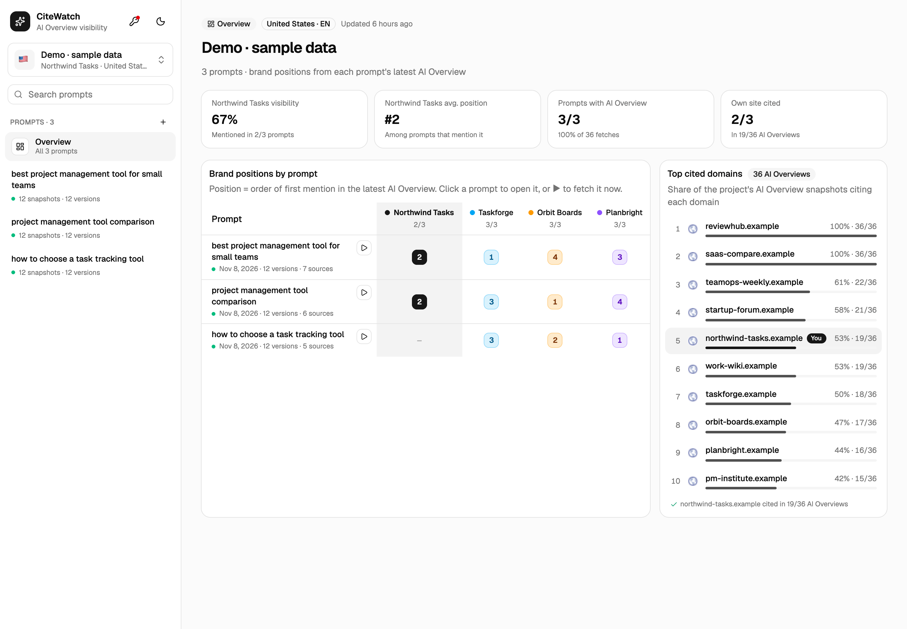
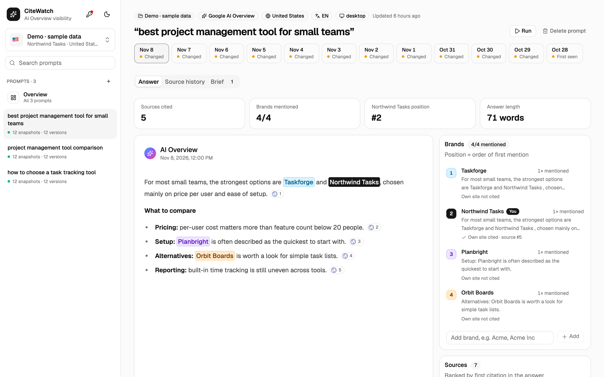

# CiteWatch

See whether Google's AI Overviews cite your site and name your brand, measured the same way every day.



## Why

"Are we in the AI Overview?" is easy to check once. But the answer can be rewritten from one day to the next, and its sources change with it. CiteWatch runs the same searches on a schedule and keeps every version, so you have a record to compare instead of a single moment.

It treats two questions separately, because they often have different answers:

- **Are we cited?** Is your domain among the sources?
- **Are we named?** Does your brand appear in the answer, and before or after your competitors?

## What it does

- Records the AI Overview for each search: full text, sources and brands.
- Shows every brand's position per search and across a project.
- Ranks the domains that get cited most often.
- Writes a content brief from all versions of an answer: what stays in every version, and what comes and goes.
- Exports briefs as Word, PDF, Markdown, text or HTML.



## Try it (about a minute, no API keys)

You need [Python 3.11 or newer](https://www.python.org/downloads/). Download this repository (**Code → Download ZIP**, or `git clone`), then in its folder run:

```bash
./start.sh
```

On Windows, double-click `start.bat`.

The app opens at http://127.0.0.1:8765 with a sample project. Its brands and data are fictional.

## Track your own searches

1. Click the **key icon** at the top of the sidebar, paste your keys and press **Test**.
2. Open the project menu and choose **New project**: name, market and your brand.
3. Add searches with **+**, then press **Run** to fetch one right away.
4. When you no longer need the sample, stop the app and run `.venv/bin/python -m citewatch demo --clear`.

| Service | Used for | Where to get a key | Cost |
|---|---|---|---|
| DataForSEO | Fetching AI Overviews | [API access](https://app.dataforseo.com/api-access) | About $0.003–0.004 per fetch in our runs |
| Gemini | Writing briefs | [AI Studio](https://aistudio.google.com/apikey) | One API call per brief |

Costs are what our own runs used, not a quote. Check each provider's pricing.

## Update it every day

The app stores new answers when a scheduled job runs `python -m citewatch run` every hour. That command fetches only what is due, based on `fetch_every_hours` in `config.toml` (daily by default).

- **macOS:** `scripts/install_schedule.sh`
- **Linux:** add this with `crontab -e`, using your folder path:
  ```
  0 * * * * cd /path/to/citewatch && .venv/bin/python -m citewatch run
  ```
- **Windows:** in Task Scheduler, create an hourly task that runs `.venv\Scripts\python.exe -m citewatch run`, starting in this folder.

## How the brief works

Once a week, an AI model reads every stored version of an answer and sorts what it finds:

- **Stable core:** what every version says. A page has to cover it to be a credible source.
- **Volatile edge:** the points and sources that come and go. This may be where a new source has the most room.

The second part is a working hypothesis, not a proven ranking factor. The tracker gives you the data to test it.

## Privacy and limits

- Your keys and data stay in this folder. The app only contacts DataForSEO and your AI provider.
- It has no login, so keep it on `127.0.0.1` and don't expose it to the internet.
- Each search is checked from one location, language and device. Other people may see a different answer.
- Being cited or named is not the same as getting traffic.
- Briefs are AI-written drafts. An editor should check them.

## For developers

Python standard-library server, SQLite, and a React interface whose built files are included in `ui/dist`. Node is only needed if you change the interface: `cd ui && npm install && npm run build`.

Settings are in `config.toml`, with comments explaining each one. Run `.venv/bin/python -m citewatch --help` for the commands. To use Claude instead of Gemini, set `provider = "anthropic"` and `pip install anthropic`.

Questions and feedback are welcome in [Issues](../../issues).

## License

[MIT](LICENSE). The bundled DejaVu fonts have [their own license](citewatch/fonts/LICENSE-DejaVu.txt).
